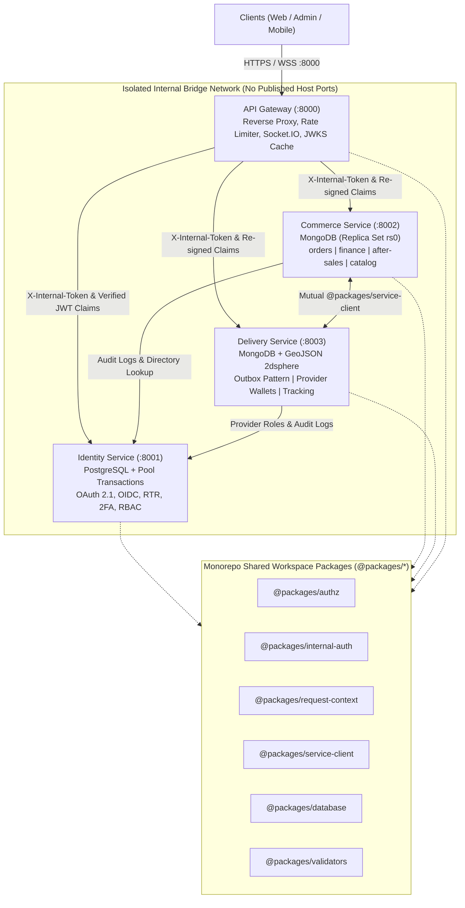

# Aritii Market — Backend Microservices

The distributed backend infrastructure for **Aritii Market**, an Ethiopian multi-vendor e-commerce marketplace and logistics platform. The platform is architected around an API Gateway routing requests to three domain microservices, backed by a polyglot persistence architecture (PostgreSQL and MongoDB) with Redis caching.

---

## 1. Architecture Overview



### Core Architecture Principles

- **Single Public Ingress:** The API Gateway (`:8000`) is the only service that publishes a host port. External clients access the platform exclusively through `/api/*` or the root `/.well-known` and `/uploads` endpoints.
- **Zero-Trust Private Microservices:** Domain services (`identity-service`, `commerce-service`, `delivery-service`) publish no host ports. Direct calls from unverified sources are immediately rejected by `gatewayOnly.js` (`403 FORBIDDEN`).
- **Mutual Internal Authentication:** Inter-service RPC uses [`@packages/service-client`](file:///home/yihunebelay/Desktop/aritii-market/backend-services/packages/service-client) and validates cluster secrets via [`@packages/internal-auth`](file:///home/yihunebelay/Desktop/aritii-market/backend-services/packages/internal-auth) (`X-Internal-Token` + `X-Internal-Service`).
- **Polyglot Persistence:**
  - **PostgreSQL (Identity):** ACID transaction safety, relational schema integrity, and foreign key enforcement for accounts, roles, and credentials.
  - **MongoDB Replica Set (Commerce & Delivery):** Flexible multi-vendor catalogs, spatial GeoJSON indexes (`2dsphere`) for zone containment, and multi-document ACID transactions.

---

## 2. Repository Structure

```text
backend-services/
├── api-gateway/            # Public reverse proxy, JWKS cache, rate limiter, Socket.IO hub (:8000)
├── identity-service/       # Auth, accounts, RBAC, OAuth 2.1 / OIDC, RTR, 2FA (PostgreSQL, :8001)
├── commerce-service/       # Modularized marketplace bounded contexts (MongoDB, :8002)
│   ├── src/modules/orders/         # Order lifecycle, inventory allocation, SLA monitoring
│   ├── src/modules/finance/        # Seller wallets, Chapa payments, payouts, commission ledgers
│   ├── src/modules/after-sales/    # Customer returns, refunds, dispute arbitration
│   ├── src/modules/catalog/        # Product listings, stock reservations, categories, reviews
│   ├── src/modules/selling/        # Multi-seller shops, applications, subscriptions, metrics
│   ├── src/modules/platform/       # Admin operations, marketplace hierarchy, analytics
│   ├── src/modules/carts/          # Persistent shopping carts, customer wishlists
│   ├── src/modules/promotions/     # Discount coupons, promotional campaigns, banner events
│   ├── src/modules/media/          # Image uploads & optimization
│   └── src/modules/chat/           # Real-time buyer-seller order messaging
├── delivery-service/       # Logistics coordination, GeoJSON zones, tracking (MongoDB, :8003)
│   ├── src/app/clients/            # Centralized cross-service HTTP clients (@packages/service-client)
│   ├── src/modules/delivery-fulfillment/ # Fulfillment lifecycle, Transactional Outbox pattern
│   ├── src/modules/locations-expansion/  # Geographic hierarchy, polygon zones, hubs, routes
│   ├── src/modules/operations/           # Single & batch dispatch assignment engine, shipments
│   ├── src/modules/provider-wallet/      # Courier driver wallets, COD settlement, payouts
│   ├── src/modules/providers/            # Provider onboarding, vehicle records, verification
│   └── src/modules/tracking/             # Milestone history, latest GPS telemetry streams
├── packages/               # Shared workspace libraries (@packages/*)
│   ├── authz/              # Standardized authorization and role validation helpers
│   ├── database/           # Managed PostgreSQL connection pool and transaction runner
│   ├── internal-auth/      # Service-to-service credential verification & token maps
│   ├── request-context/    # Distributed correlation IDs (x-request-id) and tracing
│   ├── service-client/     # Resilient HTTP client with timeouts, retries, and auth headers
│   └── validators/         # Shared payload schemas and validation utilities
├── tests/                  # Root architecture verification and cross-service test suites
├── docker-compose.yml      # Local container orchestration definition
└── .env.example            # Environment template for containerized development
```

---

## 3. Services & Persistence Strategy

| Service | Port | Persistence | Primary Responsibilities |
| :--- | :--- | :--- | :--- |
| **API Gateway** | `8000` | Redis (Cache) | Public ingress, header sanitization, JWKS caching, rate limiting, and Socket.IO hub. |
| **Identity Service** | `8001` | **PostgreSQL** | OAuth 2.1 / OIDC (PKCE), user registration, refresh token rotation, 2FA, and RBAC. |
| **Commerce Service** | `8002` | **MongoDB (rs0)** | Multi-shop catalogs, stock allocation, cart, seller wallets, payouts, and after-sales. |
| **Delivery Service** | `8003` | **MongoDB (GeoJSON)** | Location hierarchies, polygon delivery zones, dispatch, outbox sync, and tracking. |

---

## 4. Architectural Modernization Summary

The backend codebase completed a 6-phase modernization refactoring:

1. **Phase 1 (Workspace Packages):** Cleaned up duplicate local modules across all microservices and unified them under root [`@packages/*`](file:///home/yihunebelay/Desktop/aritii-market/backend-services/packages).
2. **Phase 2 (Commerce Domain Modularization):** Decomposed the monolithic fulfillment module into three clean bounded contexts: [`orders`](file:///home/yihunebelay/Desktop/aritii-market/backend-services/commerce-service/src/modules/orders), [`finance`](file:///home/yihunebelay/Desktop/aritii-market/backend-services/commerce-service/src/modules/finance), and [`after-sales`](file:///home/yihunebelay/Desktop/aritii-market/backend-services/commerce-service/src/modules/after-sales).
3. **Phase 3 (Commerce Concurrency & Security):** Implemented atomic MongoDB transactions via `withTransaction`, webhook replay protection (constant-time HMAC + timestamp tolerance), and debloated platform admin modules.
4. **Phase 4 (Delivery Outbox Resilience):** Added the Transactional Outbox pattern (`DeliveryOutboxEvent` & `outboxDispatcher`) to eliminate event loss between Delivery and Commerce, protected provider wallets against concurrent race conditions, and centralized HTTP clients under `src/app/clients/`.
5. **Phase 5 (Identity PostgreSQL Safety & 2FA):** Standardized PostgreSQL connection pooling (`@packages/database`), implemented Refresh Token Rotation (RTR) with family theft reuse detection, hardened 2FA (TOTP + constant-time comparison + single-use backup codes), and enforced response privacy mapping (`toUserResponse`).
6. **Phase 6 (API Gateway Hardening & Certification):** Configured JWKS in-memory caching with anti-DoS cooldown windows, edge header sanitization, Socket.IO handshake JWT authentication, session registry tracking, and certified 100% of all test suites.

---

## 5. Test Suite Certification: 100% Pass Rate

Run the complete test suite from the repository root:

```bash
npm test
```

### Full-System Verification Matrix (924 Tests Passed)

| Service / Test Suite | Runner | Total Tests | Passed | Failed | Status |
| :--- | :--- | :--- | :--- | :--- | :--- |
| **Root Architecture Suite** ([`tests/architecture.test.js`](file:///home/yihunebelay/Desktop/aritii-market/backend-services/tests/architecture.test.js)) | `node --test` | 7 | 7 | 0 | **PASSED** |
| **API Gateway** ([`api-gateway/`](file:///home/yihunebelay/Desktop/aritii-market/backend-services/api-gateway)) | `node --test` | 81 | 81 | 0 | **PASSED** |
| **Identity Service** ([`identity-service/`](file:///home/yihunebelay/Desktop/aritii-market/backend-services/identity-service)) | `node --test` | 98 | 98 | 0 | **PASSED** |
| **Commerce Service** ([`commerce-service/`](file:///home/yihunebelay/Desktop/aritii-market/backend-services/commerce-service)) | `node --test` | 483 | 483 | 0 | **PASSED** |
| **Delivery Service** ([`delivery-service/`](file:///home/yihunebelay/Desktop/aritii-market/backend-services/delivery-service)) | `node --test` | 255 | 255 | 0 | **PASSED** |
| **Grand Total** | **CI Gate** | **924** | **924** | **0** | **100% GREEN** |

---

## 6. Quick Start (Docker Compose)

### 1. Configure Environment
```bash
cp .env.example .env
```

Ensure `INTERNAL_SERVICE_TOKENS` defines random hex keys for all 4 services:
```bash
openssl rand -hex 32 # Repeat 4 times for gateway, identity, commerce, delivery
```

### 2. Launch Containers
```bash
docker compose up -d --build
```

### 3. Verify Health
```bash
curl http://localhost:8000/health
```

- Public API Gateway: `http://localhost:8000`
- Interactive Swagger API Documentation: `http://localhost:8000/api/docs`
- Health Endpoint: `http://localhost:8000/health`

### 4. Local Development (Independent Services)
```bash
# In backend-services/
npm install

# Run services individually in separate terminals:
cd identity-service && npm run dev
cd commerce-service && npm run dev
cd delivery-service && npm run dev
cd api-gateway && npm run dev
```

---

## 7. Documentation Directory

- [`api-gateway/README.md`](file:///home/yihunebelay/Desktop/aritii-market/backend-services/api-gateway/README.md) — Edge routing, Socket.IO, JWKS caching, and rate limiting.
- [`commerce-service/README.md`](file:///home/yihunebelay/Desktop/aritii-market/backend-services/commerce-service/README.md) — Orders, finance, after-sales, and multi-vendor catalogs.
- [`delivery-service/README.md`](file:///home/yihunebelay/Desktop/aritii-market/backend-services/delivery-service/README.md) — Outbox pattern, provider wallets, GeoJSON zones, and routing.
- [`identity-service/README.md`](file:///home/yihunebelay/Desktop/aritii-market/backend-services/identity-service/README.md) — PostgreSQL safety, OAuth 2.1, RTR, 2FA, and RBAC.
- [`docs/E2E_TESTING_GUIDE.md`](file:///home/yihunebelay/Desktop/aritii-market/backend-services/docs/E2E_TESTING_GUIDE.md) — End-to-End endpoint & concurrency testing guide with Docker Compose.
